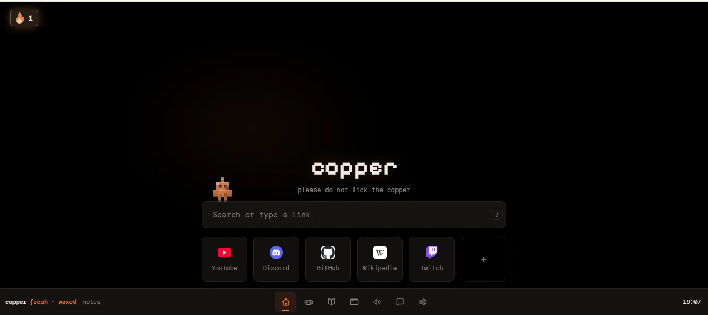

# copper

**1.1.0** — see [CHANGELOG.md](CHANGELOG.md) for what is in this release.

A start page for a browser that opens on a blank tab. Black background, copper
accent, a small golem standing on the search bar. It does the usual start-page
things — search, shortcuts, recent sites — and it also has a proxy, so most
sites open inside the page instead of a new window.

I built it because the new-tab pages I tried either wanted an account, shipped
a feed, or turned into a slow dashboard. This one is one file of HTML, one
stylesheet, and a handful of scripts with no build step.



## what's in it

- **One bar.** Type `github.com` and it opens as a tab; type `rust ownership`
  and it goes to the search engine you picked. A small badge tells you which
  one it will do before you press enter.
- **Shortcuts** in a six-column grid, stored in `localStorage`. Click the × to
  remove, the + to add.
- **Tabs** with four ways to load a site: the Lite worker, Scramjet,
  Ultraviolet, or plain direct embedding.
- **Pages** for games, manga (MangaDex), movies (TMDB) and chat (Supabase).
  All optional — an empty key just hides the feature.
- **Oxidation.** The accent moves from fresh copper to green over the first ten
  days. Click the golem to wax it back; shift-click to let it age again.
- Real addresses: `/games`, `/manga`, `/settings/general`, with back and forward
  working.
- A dot in the top right shows the Lite worker's round-trip time, red when it
  stops answering.

## layout

```
public/     the site (HTML, CSS, JS, fonts, the two proxy service workers)
worker/     the Lite proxy: a Cloudflare Worker that fetches and rewrites pages
node/       the full proxy server: Scramjet + Ultraviolet + a Wisp endpoint
supabase/   schema for the optional chat
```

## running it locally

```
npm install
npm start
```

That starts `node/server.js`, which serves `public/` and the full proxy on
`http://localhost:8080` (see the top of the file for the port). The static part
also works from any file server — `npx serve public` is enough if you only want
the start page.

## self-hosting

### 1. the site

Put `public/` on any static host. Cloudflare Workers is what this repo is set up
for — `wrangler.jsonc` uploads `public/` as assets with single-page-app fallback,
so `/games` and `/settings/theme` survive a reload:

```
npx wrangler deploy
```

Vercel works too (`vercel.json` has the same rewrites). The site is static, so a
plain bucket plus a rewrite rule is fine.

### 2. the Lite worker (needed for the proxy)

`worker/index.js` is a Cloudflare Worker that fetches a page, drops the headers
that stop it being framed, and rewrites links so they keep flowing through the
worker. No Wisp server, no Node. It is its own Worker, so it has its own config:

```
npx wrangler deploy -c wrangler.lite.jsonc
```

No wrangler? Paste the whole of `worker/index.js` over the code in the
dashboards' *Workers & Pages → copperlite → Edit code* and deploy. Either way,
the address stays the same, so nothing else needs changing. Then put its address
in `public/js/config.js` (only if you deploy it somewhere new):

```js
window.COPPER_LITE = 'https://your-worker.workers.dev';
```

Only sites listed in the worker's allow-list can be proxied through it — look
for the permission check near the top of `worker/index.js`.

### 3. the full proxy (optional)

Scramjet and Ultraviolet need a Node host with WebSockets, because they use a
Wisp server instead of rewriting pages:

```
npm install
npm start
```

Render, Railway, Fly or any box with a real port will do. Serve it over HTTPS;
Wisp will not work over plain HTTP from an HTTPS page.

### 4. spare addresses (optional)

Free static hosts make spare links, which helps when a school or work filter
blocks one domain. Each one is the start page only — Scramjet and Ultraviolet
need the Node server, so a mirror browses through Lite or direct, which is what
`Fast` already picks.

```
npx wrangler pages deploy public --project-name copper   # copper.pages.dev
npx netlify deploy --prod --dir public                   # copper.netlify.app
npx vercel --prod                                        # copper.vercel.app
npm run deploy:surge                                     # copper-start.surge.sh
```

Surge has no rewrite config, so `node/surge.js` copies `index.html` to
`200.html` for the upload — its fallback for any unknown path — and removes it
again. The first run asks for an email and password and creates the account.
Pick another domain with `npm run deploy:surge -- another.surge.sh`.

Surge attaches a domain you already own for free, certificate included — it does
not give you one. `npm run deploy:surge -- yourdomain.com` publishes straight
away and prints the records to add (`www CNAME geo.surge.world`, or delegate the
domain to `ns1`–`ns4.surge.world`). Check progress with
`npx surge yourdomain.com status`.

Every mirror origin has to be in the Lite worker's `ALLOWED` list
(`worker/index.js`) — the three above are, and anything with a generated name
(`copper-abc123.vercel.app`) must be added and the worker redeployed.
`public/_redirects` gives Pages and Netlify the same single-page fallback the
Worker config has. GitHub Pages has no rewrites, so deep links there need a copy
of `index.html` named `404.html`.

A mirror is only as useful as the worker behind it: they all call the same Lite
worker, so a filter that blocks `workers.dev` outright takes the proxy down on
every one of them. A custom domain for the worker is the only cure for that.

## configuration

`public/js/config.js` holds the things you might want to change:

| key | what it does |
| --- | --- |
| `COPPER_LITE` | address of your Lite worker |
| `COPPER_TMDB` | TMDB key for the movies page |
| `COPPER_MOVIES_API` | your own movies api; when it answers, TMDB above is only the fallback |
| `COPPER_GA` | GA4 measurement id; leave empty for no analytics |
| `COPPER_GTM` | Tag Manager container; loads with the same switch as analytics |
| `COPPER_CONTACT` | shown under settings → credit |

The worker keeps its own secrets; nothing on these pages needs a key from you
beyond `COPPER_TMDB`, an optional movies api address, and your Lite worker.

## what it does not do

- It is not a VPN. The Lite worker fetches pages for you; it does not hide your
  address from the site you visit, and it only sees sites you allow in it.
- It does not bypass logins or paywalls, and some sites will still refuse to be
  framed no matter what headers are stripped.
- Nothing is stored on a server except chat messages, if you turn chat on.

## credit

Game pages and their artwork come from [ShadowDevLabs/files](https://github.com/ShadowDevLabs/files)
(the 3kh0 game ports), served through githack and jsDelivr. Manga data from
MangaDex, movie data from TMDB, and films play through our own movies api, with
the credit page naming each source. The golem, the fonts and everything else are
in this repo.

## licence

MIT — see [LICENSE](LICENSE).
